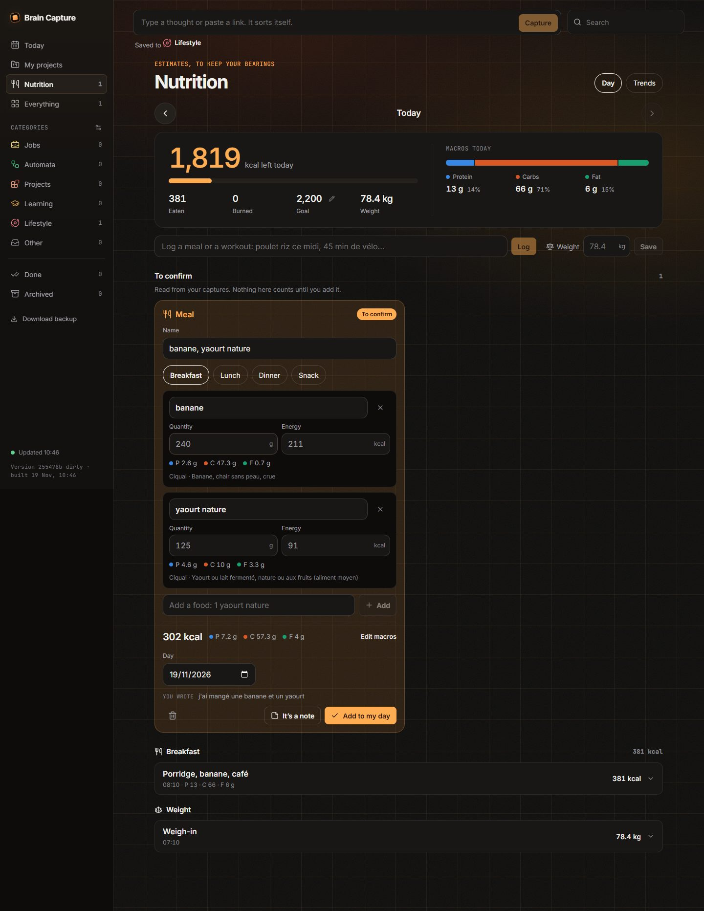
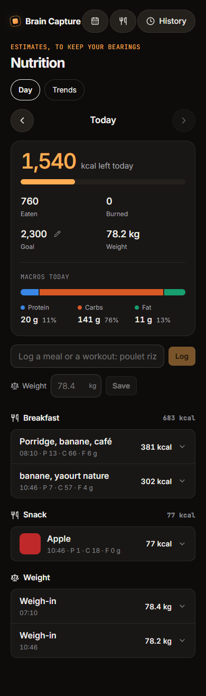
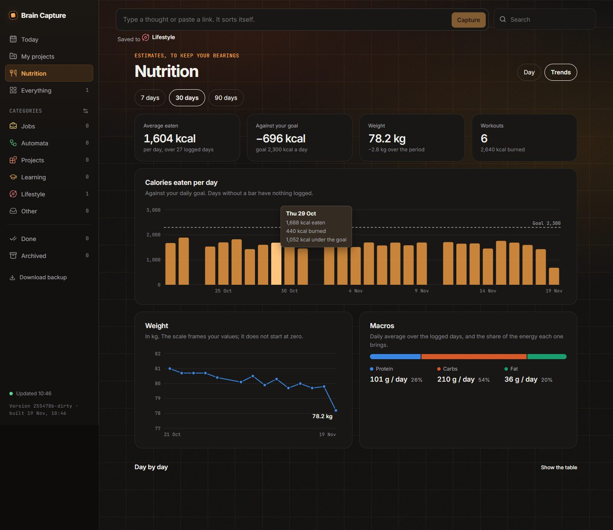
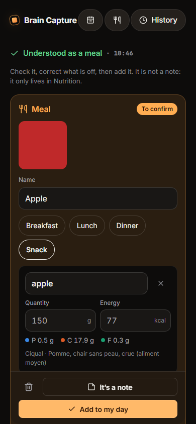

# Nutrition : repas, sport, poids

## Ce que fait l’app

Brain Capture a trois volets séparés. Une capture (voix, texte ou photo) devient soit une
note classée dans une catégorie, soit une demande d’agenda (`docs/calendar-events.md`), soit
une entrée Nutrition : un repas, une séance de sport ou une pesée.

**Un repas, un sport ou une pesée n’est jamais une note.** Il n’apparaît dans aucune
catégorie, ni dans l’historique des notes, ni dans Today, ni dans les compteurs. Il vit dans
la section Nutrition (`/nutrition`, sur téléphone et sur ordinateur).

Tous les chiffres sont des **estimations**, pour garder des repères : ce n’est pas un outil
de précision.

Exemples tenus par les tests et par l’évaluation réelle :

| Capture | Devient |
| --- | --- |
| « j’ai mangé une banane » | repas |
| « acheter des bananes » | note |
| « 45 min de vélo » | sport |
| « je pèse 78,4 » | pesée |
| « mets dans mon agenda déjeuner avec Sarah vendredi à 12h30 » | demande d’agenda |

## La carte

Comme pour l’agenda, une carte montre ce qui a été compris, et rien ne compte avant le tap :

- **Repas** : le moment (Breakfast, Lunch, Dinner, Snack), puis chaque aliment avec sa
  quantité en grammes, ses calories, ses macros et l’origine de ses valeurs. Changer une
  quantité recalcule l’aliment à partir de ses valeurs pour 100 g. Taper une valeur à la main
  la fige (l’aliment est alors marqué « By hand »). On peut retirer un aliment, ou en ajouter
  un en quelques mots (« 1 yaourt nature »), lu de la même façon.
- **Sport** : activité, durée, calories dépensées. Changer la durée recalcule les calories.
- **Pesée** : le poids en kg.
- Le jour est modifiable (« hier soir j’ai mangé une pizza » arrive déjà sur la veille).
- **Add to my day** valide en un tap. Tant qu’une entrée n’est pas validée, elle attend dans
  Nutrition sous « To confirm » et ne compte dans aucun total.
- **It’s a note** : la détection s’est trompée. L’entrée quitte Nutrition et redevient la note
  qu’elle aurait dû être (même texte), classée dans une catégorie. Elle ne repassera plus en
  Nutrition toute seule.
- Dans l’autre sens, une note que la détection a laissée passer a un lien **Log in
  Nutrition** : elle est relue et quitte les notes.
- Une entrée validée reste modifiable et supprimable depuis la journée.

Sur téléphone, juste après la capture, les boutons de la carte restent en bas de l’écran.

## Photo

Le bouton Photo de l’écran de capture ouvre l’appareil ou la galerie. Une phrase
d’accompagnement est possible (« j’en ai mangé la moitié »), jamais obligatoire : la photo
d’une pomme suffit.

- La photo est réduite sur le téléphone (1 280 px au plus, quelques centaines de Ko) avant
  d’être gardée en attente ou envoyée.
- Le modèle de vision dit ce qu’il voit : un repas (aliments et quantités estimées), l’écran
  d’une balance (poids), le résumé d’une montre ou d’une app de sport (activité, durée,
  calories affichées), ou autre chose.
- Autre chose (document, capture d’écran, lieu…) devient une **note** contenant la phrase et
  le texte lu dans l’image. L’image n’est pas gardée sur les notes.
- **Conservation** : le serveur ne garde jamais la photo envoyée, lue en mémoire puis
  libérée. Seule une miniature (320 px, environ 20 Ko) est gardée avec le repas, dans la
  base existante, pour reconnaître l’assiette dans la journée. Aucun stockage payant. Les
  miniatures ne sont pas dans la sauvegarde JSON.
- Comme une note vocale, la photo reste sur le téléphone tant que le serveur n’a pas confirmé.
  Si la lecture est indisponible, l’envoi repart seul ; si la photo est refusée, elle reste
  sur l’appareil et on peut en prendre une autre.

## D’où viennent les valeurs

L’IA découpe le repas en aliments et en quantités, et donne sa propre estimation pour 100 g.
Les valeurs affichées viennent ensuite, dans cet ordre :

1. **Open Food Facts**, seulement quand une marque ou un produit est cité (« un Activia »,
   « un Big Mac »). API gratuite, sans clé. Elle répond parfois lentement ou pas du tout :
   quatre secondes au plus, et on passe à la suite.
2. **Ciqual**, la table de composition de l’Anses (édition 2025, 3 341 aliments avec énergie,
   protéines, glucides, lipides pour 100 g), embarquée dans l’app : aucun appel réseau.
3. **L’estimation de l’IA**, quand ni l’une ni l’autre n’a de correspondance crédible.
   L’entrée l’indique : « AI estimate · no match in the food tables ».

Le rapprochement avec Ciqual se fait sur le nom français générique que donne le modèle
(« riz blanc cuit », « poulet filet cuit »). Deux garde-fous évitent les faux amis : la
majorité des mots dits doivent se retrouver dans le nom de la table, et l’aliment trouvé doit
rester proche de l’estimation du modèle (« pomme » ne devient pas « pomme de terre frite »,
« banane » à 89 kcal ne devient pas « banane séchée »). Mieux vaut une estimation signalée
qu’une mauvaise ligne de table. Sur 95 aliments courants essayés, 83 trouvent leur ligne ;
les autres (kebab, pad thaï, poké bowl, whey…) restent des estimations.

Les quantités non dites sont des portions usuelles (un fruit 120 à 150 g, une assiette de
pâtes cuites 250 g, une viande 130 g, un verre 200 g…). C’est le premier chiffre à corriger
sur la carte quand il compte.

Régénérer la table : `node scripts/build-ciqual.mjs <dossier des XML Ciqual>` (fichiers sur
ciqual.anses.fr ou sur Zenodo, doi:10.5281/zenodo.17550133). Les XML ne sont pas dans le dépôt
(69 Mo) ; seul le fichier généré `src/server/nutrition/ciqual-data.ts` l’est (240 Ko).

Sources et licences : Anses, Table de composition nutritionnelle des aliments Ciqual 2025
(Licence Ouverte / CC-BY 4.0). Open Food Facts (Open Database License), données interrogées à
la demande, rien n’est copié dans l’app.

## Sport et bilan du jour

Calories dépensées = **MET × poids × durée en heures**. Le MET (intensité de l’activité) vient
du modèle (marche 3,5, vélo 7,5, course 9,8…), le poids est la dernière pesée validée, 75 kg
tant qu’il n’y en a aucune. Si la capture donne elle-même les calories (« 410 kcal à la
montre »), elles sont gardées. Sans durée dite, la carte propose 30 minutes.

Bilan : **reste = objectif − mangé + dépensé**. L’objectif quotidien se règle dans la vue du
jour (crayon à côté de « Goal »). Tant qu’il n’est pas réglé, 2 000 kcal sert de repère et
l’écran le dit.

## La section

- **Day** : navigation jour par jour, ce qu’il reste pour la journée, mangé, dépensé,
  objectif, dernier poids, répartition des macros du jour, les entrées à confirmer, puis les
  repas par moment, les séances et les pesées. Une ligne s’ouvre pour modifier ou supprimer.
  Un champ permet de saisir un repas ou un sport en une phrase, un autre le poids à la main.
- **Trends** (7, 30 ou 90 jours) : moyenne mangée par jour, écart à l’objectif, poids et
  variation, séances ; **calories par jour face à l’objectif** (barres et ligne d’objectif, un
  jour sans saisie reste vide plutôt qu’à zéro) ; **courbe du poids** ; **répartition des
  macros** (moyenne par jour et part de l’énergie). Le survol donne le détail d’un jour, et
  « Show the table » donne les mêmes chiffres en tableau.

Les trois couleurs des macros (protéines `#3987e5`, glucides `#d95926`, lipides `#199e70`) ont
été vérifiées ensemble sur le fond de l’app : séparation pour les daltoniens, contraste et
plage de luminosité. Elles ne colorent que des marques, jamais du texte, et chaque part est
nommée et chiffrée sous la barre.

Pas dans cette version : les projections de poids (`docs/future-improvements.md`).

## Comment c’est fait

- **Détection** (`src/server/captures/sort.ts`). La capture est d’abord enregistrée comme
  aujourd’hui, pour ne jamais la perdre. Le classement existant dit aussi ce qu’elle est
  (`intent` : note, meal, workout, weight), dans le même appel, donc sans coût en plus pour
  une note. Pour un repas, un sport ou une pesée, une lecture complète suit
  (`src/server/ai/nutrition-prompt.ts`) et a le dernier mot : si elle ne trouve rien à
  enregistrer, la capture reste une note. Sinon la capture quitte les notes et l’entrée prend
  sa place (même identifiant), dans une seule transaction : jamais aux deux endroits, jamais
  à aucun.
- **Priorités** : un lien est toujours une note ; une demande d’agenda explicite reste une
  demande d’agenda, quel que soit l’événement.
- **Si Groq est injoignable**, la capture est sauvée et reste sous Other comme avant ; la
  relance automatique la reconnaît plus tard et la déplace alors en Nutrition, sur le jour où
  elle a été faite (l’heure et le fuseau du téléphone sont gardés avec la capture). C’est le
  seul moment où un repas peut se trouver parmi les notes.
- **Une capture, un seul endroit** : l’identifiant donné par l’appareil vit soit dans les
  notes, soit dans Nutrition, soit dans les suppressions définitives, sous le même verrou
  que les captures. Un renvoi après une réponse perdue retrouve la même entrée sans nouvel
  appel au modèle ; une entrée supprimée ne revient pas.
- **Ancienne version de l’app** encore en cache : elle n’annonce pas qu’elle connaît
  Nutrition, le serveur lui rend donc sa note comme avant. La mise à jour de l’app se fait
  seule à l’ouverture suivante.
- **Tables** (migration `0005_nutrition`, qui ne fait qu’ajouter) : `nutrition_entries`,
  `nutrition_photos` (miniatures), `nutrition_settings` (objectif), et trois colonnes sur
  `captures` (heure et fuseau du téléphone, marque « gardée comme note »).
- **Sauvegarde** : les entrées et l’objectif sont dans l’export JSON ; une sauvegarde
  d’avant ce volet s’importe comme avant (`docs/backup-restore.md`).

## Offre gratuite Groq

Aucune API ni abonnement payant. Même clé qu’avant.

- Texte et voix : `openai/gpt-oss-20b`, un appel par note (comme avant), deux pour un repas,
  un sport ou une pesée. 8 000 tokens par minute, 1 000 requêtes par jour.
- Photo : `qwen/qwen3.8-27b`, le seul modèle de vision de l’offre gratuite (novembre 2026).
  Une image compte pour environ 2 000 tokens sur 8 000 par minute : **deux photos par
  minute**, 1 000 requêtes par jour. La troisième dans la minute attend sur le téléphone et
  repart seule.

## Preuves

### Évaluation réelle sur Groq (19/11/2026)

`scripts/eval-intent.ts`, offre gratuite, modèles réels, mêmes étapes que l’app : **43 sur 44
exacts, 44 sur 44 acceptables, aucune erreur.** La première lecture (le classement seul) est
juste 42 fois sur 44 ; la lecture complète rattrape les deux autres.

| Série | Cas | Résultat |
| --- | --- | --- |
| Les quatre exemples du brief | 4 | 4 / 4 |
| Notes qui parlent de nourriture, de sport ou de poids (« acheter des bananes », « aller courir demain », « objectif : descendre à 75 kilos », « le bébé de Marie pesait 3,4 kilos »…) | 15 | 15 / 15 en note |
| Demandes d’agenda (« mets dans mon agenda déjeuner avec Sarah… ») | 3 | 3 / 3 en agenda |
| Repas, en français et en anglais, dont « hier soir » | 9 | 9 / 9, bon jour compris |
| Sport, dont « couru 5 km » (durée déduite) et « hier soir » | 5 | 5 / 5 |
| Pesées, dont « 172 pounds » converti en 78 kg | 3 | 3 / 3 |
| Ambigus (« Banane », « Pizza ce soir ? », « Trop mangé ce midi… », « Vélo ») | 4 | 3 exacts, 1 acceptable |
| Tentative d’injection dans une note de courses | 1 | reste une note |

Le seul écart : « Vélo », tout seul, est lu comme une séance de 30 minutes à confirmer. Les
deux lectures se défendent, et « It’s a note » corrige en un tap.

Quelques lectures, telles que la carte les montrerait :

- « Ce midi poulet rôti, riz et haricots verts » : 726 kcal, trois aliments, tous Ciqual.
- « Petit-déj : deux oeufs brouillés, une tranche de pain complet et un café » : 260 kcal.
- « Hier soir j’ai mangé une pizza margherita entière » : 784 kcal, sur la veille, Dinner.
- « Je viens de boire une pinte de bière blonde » : 568 g, 244 kcal (estimation IA).
- « un Big Mac et une moyenne frite » : environ 865 kcal (estimation IA). Au premier passage
  le Big Mac sortait à 1 092 kcal : le modèle donnait les calories de la portion à la place
  des calories pour 100 g. Le prompt le précise maintenant, exemple à l’appui.
- « J’ai couru 5 km ce matin » : 30 min, 368 kcal. « Padel pendant 1h30 hier soir » : 675 kcal,
  sur la veille.

`scripts/eval-photo.ts`, modèle de vision réel, photos libres de Wikimedia Commons réduites
comme sur le téléphone, sans phrase sauf mention :

| Photo | Lu en | Résultat |
| --- | --- | --- |
| Une banane seule | 1,2 s | repas « Banane », 120 g, 106 kcal (Ciqual) |
| Une pomme seule | 1,4 s | repas, 150 g, 77 kcal (Ciqual) |
| Une assiette de spaghetti bolognaise aux petits pois | 2,2 s | 3 aliments : spaghetti 250 g, bolognaise 130 g, petits pois 50 g, 724 kcal |
| La même, avec « J’en ai mangé la moitié » | 1,9 s | quantités divisées par deux, 376 kcal |

La quatrième photo envoyée dans la même minute a reçu un 429 de Groq (limite de tokens par
minute) : c’est le cas « deux photos par minute » décrit plus haut, que l’app rattrape en
renvoyant seule.

### Tests

`npm test` : routage des intentions (`tests/intent-routing.test.ts`), entrées, photo, bilan,
historique (`tests/nutrition.test.ts`), rapprochement des aliments, prompts et calculs
(`tests/food-lookup.test.ts`), sauvegarde (`tests/nutrition-backup.test.ts`).

`node scripts/check-nutrition.mjs` : le parcours complet dans un vrai navigateur, sur
ordinateur et sur téléphone, base isolée en mémoire.

### Captures d’écran

| Ordinateur | Téléphone |
| --- | --- |
|  |  |
|  |  |

## Limites

- Estimations partout : portions usuelles quand rien n’est dit, pas d’huile de cuisson ni de
  sauce invisible sur une photo, valeurs moyennes de table.
- Un plat composé (« pizza », « quiche ») est un seul aliment, avec la valeur moyenne de la
  table ou l’estimation du modèle.
- Les calories de sport sont brutes (MET complet), sans retirer la dépense au repos.
- Open Food Facts choisit le premier produit de la marque citée dont les valeurs sont
  plausibles : ce n’est pas forcément la bonne déclinaison.
- Une photo qui n’est pas pour Nutrition devient une note sans image.
